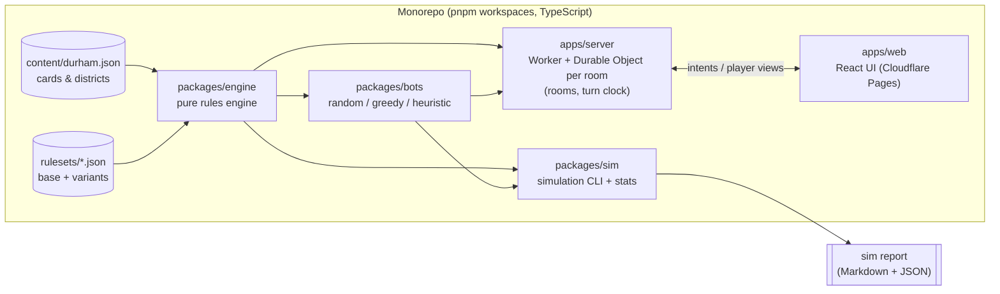
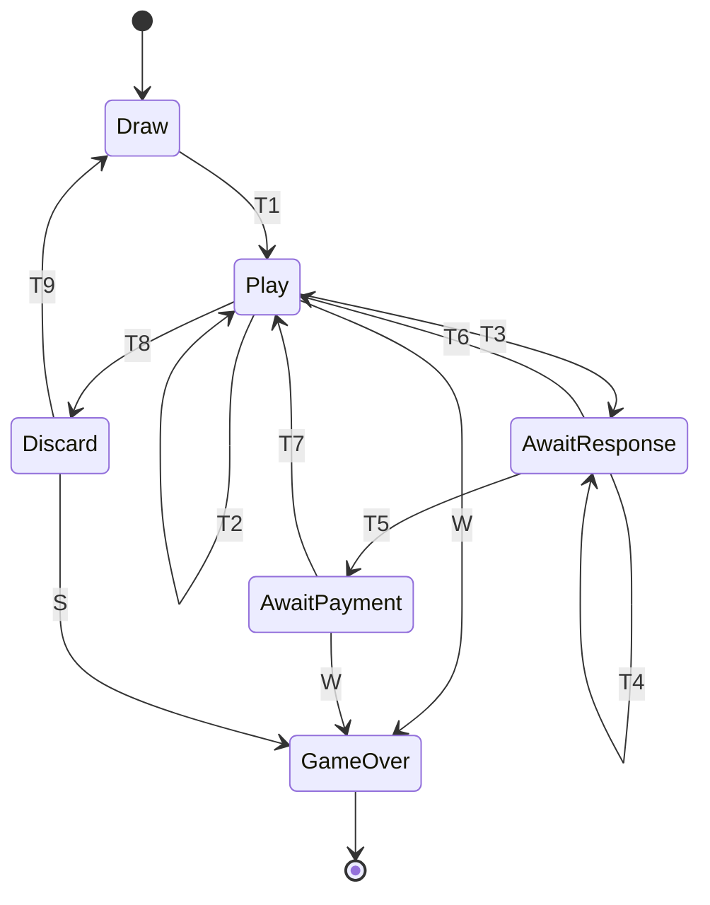
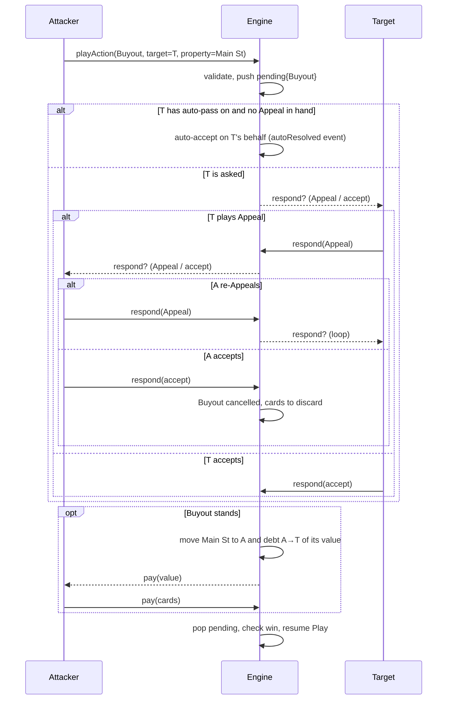
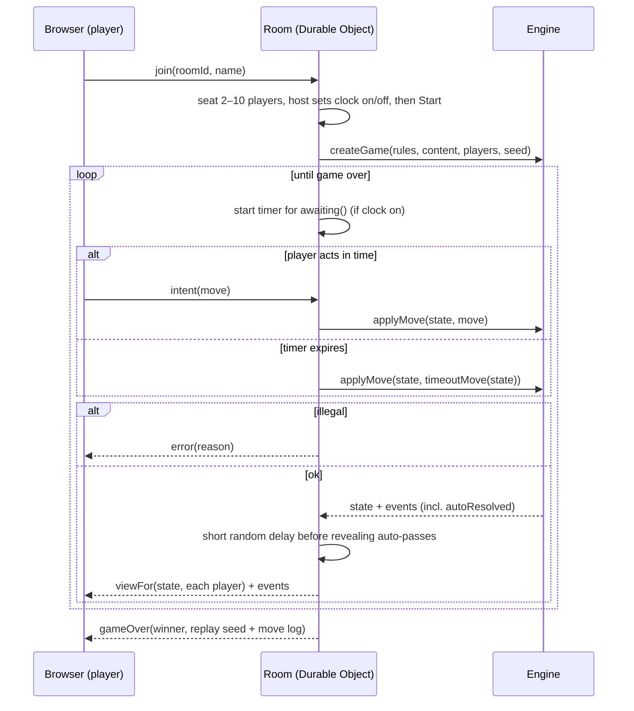
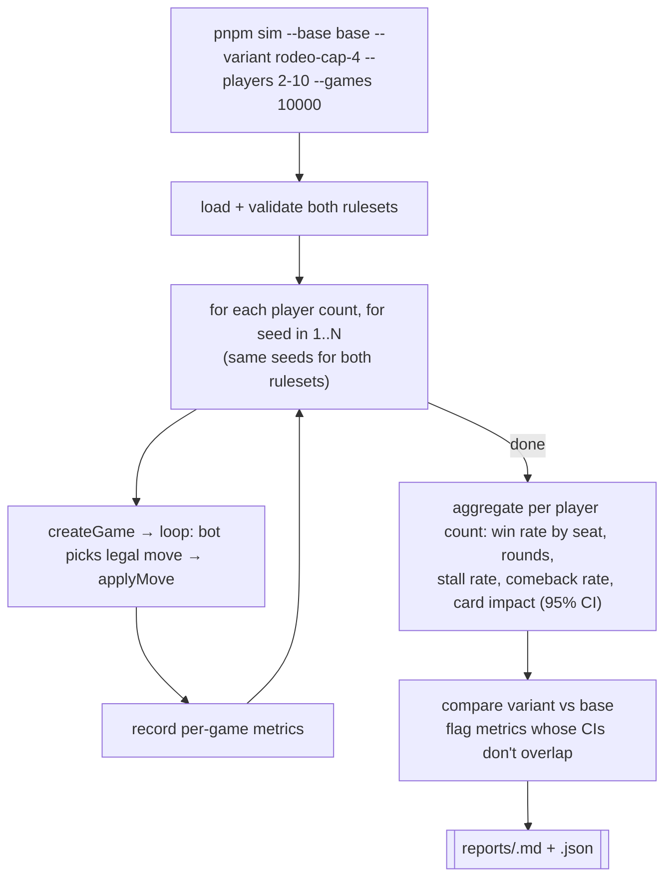

# Architecture

> Status: **DRAFT v0.1, awaiting owner approval.**

## 1. Principles

1. **The engine is pure.** It has no I/O, no clock and no `Math.random`. The same seed and the same moves always produce the same game, which is what makes simulations, replays and bug reports trustworthy.
2. **Rules are data.** Numbers live in a `RuleSet`, and card content lives in `content/`. Code changes are only needed for new *kinds* of rules, and those go through hooks.
3. **The server is authoritative.** Online clients send *intents*. The server validates them with the same engine and broadcasts each player's own view of the game, so hidden hands stay hidden.
4. **Small packages with one-way dependencies.** The engine depends on nothing.

## 2. System overview



| Package | Responsibility | Depends on |
|---|---|---|
| `packages/engine` | Game state, legal moves, applying moves, per-player views, ruleset loading and validation, hooks | nothing at runtime except `zod` |
| `packages/bots` | `Policy` implementations that pick a move from `legalMoves` | engine |
| `packages/sim` | Runs N games across seeds, collects metrics, compares rulesets, writes reports | engine, bots |
| `apps/server` | Rooms, seats and reconnects. Runs the engine, broadcasts views and owns turn-clock timers (M4). Deployed as a Cloudflare Worker with one Durable Object per room | engine, bots (for filling empty seats) |
| `apps/web` | Renders the player view and sends intents (M4) | engine types only |

## 3. Engine API

```ts
// Everything is serializable JSON, so any game can be saved, replayed or diffed.
createGame(rules: RuleSet, content: Content, players: PlayerId[], seed: string): Result<GameState>  // error result for a bad player count
legalMoves(state: GameState, player: PlayerId): Move[]
applyMove(state: GameState, move: Move): { state: GameState; events: GameEvent[] }
viewFor(state: GameState, player: PlayerId): PlayerView   // hides other players' hands and the deck order
winner(state: GameState): PlayerId | "stall" | null
awaiting(state: GameState): { player: PlayerId; kind: "play" | "discard" | "respond" | "pay" } | null
timeoutMove(state: GameState): Move   // the fixed default move for whoever is awaited (SPEC §3.7)
```

- `GameState` holds `phase` (`play`, `discard` or `gameOver`; the draw happens automatically when a turn starts, including the first turn inside `createGame`), `currentPlayer`, `startingPlayer`, `result`, `playsRemaining`, a `pending` stack (debts and Appeal chains waiting for a response), `players[]` (hand, bank, tableau, **prefs**), `deck`, `discard`, `rng` (seeded PRNG state), `turn` and `round`.
- `Move` is a discriminated union, for example `{type:"playProperty"}`, `{type:"bank"}`, `{type:"playAction"}`, `{type:"respond"}`, `{type:"pay"}`, `{type:"endTurn"}`, `{type:"discard"}`, `{type:"moveWild"}`, `{type:"setPref"}`. `setPref` is allowed at any time and is never counted as a play.
- **Auto-resolution happens inside `applyMove`.** After every move, the engine repeatedly resolves the next pending step while either of these holds:
  - The awaited player has auto-pass on and no Appeal in hand. The engine accepts for them.
  - The awaited player owes at least everything they own. The engine pays it all.

  Because auto-resolution is part of `applyMove`, it is deterministic and replays identically. Each auto-resolved step emits an `autoResolved` event, so the UI can show what happened.
- **The clock lives outside the engine.** The server starts a timer whenever `awaiting()` changes. If the timer expires, the server calls `applyMove(state, timeoutMove(state))`. The engine never reads time.
- A move from a player who is not allowed to act returns an error. It never throws.

## 4. Game flow

### 4.1 Turn state machine



| Edge | Condition |
|---|---|
| T1 | Draw 2 cards, or 5 if your hand is empty |
| T2 | Play a card while plays remain |
| T3 | An action or rent card targets other players |
| T4 | The target plays Appeal, or the attacker re-Appeals. If the awaited player has auto-pass on and no Appeal, the engine accepts for them and goes straight to T5 or T6 |
| T5 | The action stands and requires payment |
| T6 | The action was cancelled, or it resolved without payment |
| T7 | All targets have paid. Payment is automatic when a target owes at least everything they own |
| T8 | `endTurn` is played, or no plays remain |
| T9 | Hand is at or under the limit, so the turn passes to the next player |
| W | A player has 3 complete districts: they win, checked after every move |
| S | The round limit is reached: the game is a stall |

If the turn clock is on and the awaited player's timer expires in any state, the server applies `timeoutMove` (SPEC §3.7).

### 4.2 Resolving a targeted action (Appeal chain)



### 4.3 Online play (M4)



## 5. Simulation pipeline



- **Paired seeds:** both rulesets are run on the same seeds, which reduces noise in the comparison.
- **Parallelism:** games run in worker threads. A run of 10,000 games at a single player count should take under 2 minutes in a cloud session. A full sweep across all 9 player counts takes longer, so it is used only for variant reports.
- **CI budget:** pull requests run a smoke test of 500 games. Full runs of 10,000 games happen in the implementation session, and their report is committed.

## 6. Tech stack

| Concern | Choice | Why |
|---|---|---|
| Language | TypeScript (strict) everywhere | One language shared by engine, server and UI |
| Packages | pnpm workspaces | Fast and cheap installs in CI and sessions |
| Validation | zod | Validates rulesets and content at load time |
| Tests | Vitest, plus property-based tests with fast-check | Invariants like "card count is conserved" catch whole classes of bugs |
| Lint/format | Biome | One fast tool instead of ESLint plus Prettier |
| Server (M4) | Cloudflare Worker with Durable Objects, using WebSocket hibernation | Free tier, one object per room, and built-in timers through alarms |
| Web (M4) | React + Vite on Cloudflare Pages | Standard and free |
| Local dev server | Node + `ws`, wrapping the same room logic | Lets people play locally and run tests without Cloudflare |

## 7. Engine invariants (enforced by property tests)

1. The total number of cards across deck, discard, hands, banks and tableaux always equals the deck size.
2. `applyMove` never mutates its input state.
3. Replaying the same seed and move log produces an identical final state.
4. Every move returned by `legalMoves` applies without error.
5. `viewFor(p)` never contains other players' hand contents or the deck order.
6. `timeoutMove(state)` is always legal and depends only on the state.
7. After `applyMove` returns, the awaited player is never someone who should have been auto-resolved.
8. All of the above hold for every player count from 2 to 10.
