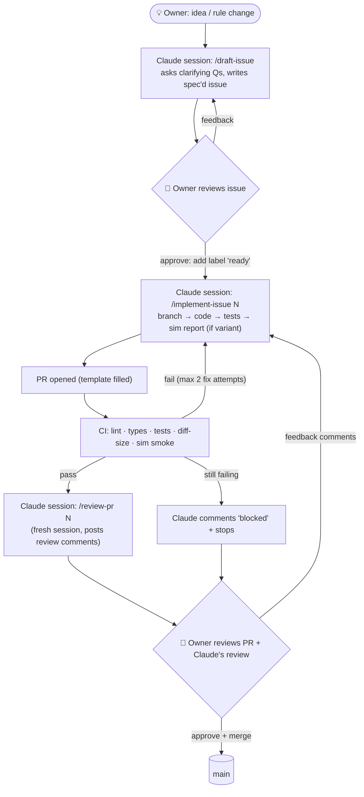

# Development Workflow & Guardrails

> Status: **DRAFT v0.1, awaiting owner approval.**
>
> **Owner:** decides what to build, and approves every issue and every merge.
> **Claude:** drafts issues, implements, self-checks, reviews.

## 1. The loop

There are two human gates, and nothing gets past them on its own:

- **Gate 1:** an issue isn't worked on until the owner adds the `ready` label.
- **Gate 2:** nothing reaches `main` without the owner's approval and a merge. Claude cannot merge.

## 2. Hard guardrails (enforced, not just requested)

| Guardrail | How it's enforced |
|---|---|
| No direct pushes to `main` | GitHub branch protection on `main`: pull request required and force pushes blocked. Claude acts through the owner's GitHub identity, so GitHub's "required approvals" can't be used: the owner's merge **is** the approval |
| Claude can't merge or approve | `.claude/settings.json` denies `gh pr merge`, approve and merge calls through `gh api`, pushes to `main`, and `DELETE` calls. Cloud sessions also can't change repo settings or branch protection; the GitHub proxy refuses those writes |
| CI must pass | Required status checks in branch protection (added once #2 lands) |
| Small pull requests | CI fails when the diff is over **400 changed lines**, excluding lockfiles, `content/`, `reports/`, `docs/`, test files (`*.test.ts`) and fixtures (`fixtures/`, `__fixtures__/`) |
| No surprise dependencies | CI fails when `package.json` dependencies change unless the issue has the `deps-approved` label |
| No secrets in cloud sessions | The environment has no production credentials, and network access is limited to package registries and GitHub |
| Simulation runs are bounded | CI runs 500 games, and the CLI refuses to run more than 50,000 games without `--i-mean-it` |

## 3. Cost controls

| Lever | Rule |
|---|---|
| One issue per session | Sessions start fresh, so long contexts don't pile up cost |
| Issue size | Issues must be **S** (≤ ~150 lines) or **M** (≤ ~400 lines). Anything bigger gets split by `/draft-issue` |
| Model choice | Implementation and fixes use the cheaper default model. The strongest model is used only for spec and architecture changes, or when the owner asks for it |
| Retry cap | 2 CI-fix attempts at most, then stop and comment `blocked:` with a diagnosis |
| Context is precomputed | `CLAUDE.md` and these docs tell the agent where things are, so it doesn't spend tokens exploring |
| Setup script | Dependencies install when the environment is built, not at the start of every session |
| Manual starts | The owner starts each implementation session manually. Scheduled automation comes later, once the owner opts in |

## 4. Issue lifecycle and labels

| Label | Meaning |
|---|---|
| `draft` | Written by Claude, not yet approved |
| `ready` | Approved by the owner, OK to implement |
| `in-progress` | A session is working on it |
| `blocked` | The agent stopped and needs the owner |
| `variant` | Proposes a rule variant, so a simulation report is required |
| `deps-approved` | The owner allows dependency changes for this issue |
| `size:S` / `size:M` | Size estimate |

## 5. Commands (Claude Code skills in `.claude/skills/`)

| Command | Who runs it | What it does |
|---|---|---|
| `/draft-issue <idea>` | Owner | Asks up to 3 clarifying questions, then writes an issue using the template, with acceptance criteria and a test plan, and opens it with the `draft` label |
| `/implement-issue <N>` | Owner (starts the session) | Checks for the `ready` label, branches, implements, tests, runs a full simulation for `variant` issues, opens a pull request |
| `/review-pr <N>` | Owner (in a fresh session) | Reviews the pull request against the issue and the spec, then posts comments. It never approves |

## 6. Automation later (opt-in)

Each step requires the owner's go-ahead:

1. A scheduled task picks up the oldest `ready` issue once a day.
2. When a pull request opens, a review session starts automatically.
3. Auto-merge for `size:S` pull requests that touch only `rulesets/` and `reports/`.
